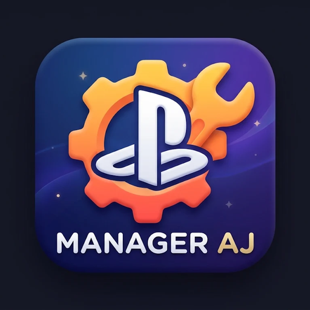

<p align="center">
  
</p>

<h1 align="center">🎮 PS4 Manager Tools AJ 4.5.7</h1>
<p align="center"><strong>Tu consola, tus herramientas, tu red local.</strong><br>Administra y consulta una PS4 con GoldHEN desde Android o Windows.</p>

<p align="center">
  <a href="https://github.com/AJfiles/PS4-MANAGER-TOOL-AJ/releases/latest"></a>
  <a href="https://github.com/AJfiles/PS4-MANAGER-TOOL-AJ/releases"></a>
  
  
</p>

PS4 Manager Tools es una aplicación local que reúne herramientas de biblioteca, partidas, capturas, organización XMB, plugins, parches, payloads, ventilador, transferencias y archivos. Se conecta a la PS4 directamente por la red local; no requiere una cuenta ni sube el contenido de la consola a un servicio en la nube.

## 🚀 Descarga y empieza

| Plataforma | Descarga o instalación | Inicio rápido |
| --- | --- | --- |
| **📱 Android · Termux** | [Instalar / actualizar desde GitHub](https://github.com/AJfiles/PS4-MANAGER-TOOL-AJ) | Pega el comando de abajo en Termux. |
| **📦 Android · APK** | [Descargar APK 4.5.7](https://github.com/AJfiles/PS4-MANAGER-TOOL-AJ/releases/download/v4.5.7/PS4-Manager-Tools-AJ-v4.5.7.apk) | Instálala y abre **PS4 Manager Tools AJ**. No necesitas Termux. |
| **🖥️ Windows · PC** | [Descargar paquete PC 4.5.7](https://github.com/AJfiles/PS4-MANAGER-TOOL-AJ/releases/download/v4.5.7/PS4-Manager-Tools-AJ-PC-v4.5.7.zip) | Descomprime y ejecuta `Iniciar-PS4-Manager-Tool.bat`. |

Consulta los cambios y versiones anteriores en [GitHub Releases](https://github.com/AJfiles/PS4-MANAGER-TOOL-AJ/releases).

### Instalar en Termux

Instala Termux desde una fuente confiable, ábrelo y pega:

```bash
curl -sL https://raw.githubusercontent.com/AJfiles/PS4-MANAGER-TOOL-AJ/main/goldhen.sh | bash
```

El instalador prepara PHP y las dependencias, crea el acceso `goldhen` y abre el panel local. En instalaciones nuevas, los archivos del proyecto y respaldos van a **Almacenamiento interno/PS4 Manager Tools AJ/user/**. Al actualizar una instalación antigua, se conservan sus datos y rutas para evitar pérdidas.

### Instalar el APK

Descarga el APK desde el botón de arriba, instálalo y confirma el permiso de instalación que muestre Android. El nombre de la app en el teléfono es **PS4 Manager Tools AJ**; el título dentro de la aplicación es **PS4 Manager Tools**.

En la APK, abre **Ajustes → Carpeta de exportaciones → Elegir carpeta** y selecciona la carpeta `PS4 Manager Tools AJ` del almacenamiento compartido (puedes crearla desde el selector). Las exportaciones compatibles se guardan directamente en la carpeta elegida. Android conserva el permiso para esta APK; si no eliges una carpeta, usa su selector normal. Las actualizaciones se descargan mediante el sistema y requieren que confirmes la instalación. Los archivos internos de trabajo siguen en el espacio privado de la app; conserva una copia externa antes de desinstalarla.

### Ejecutar en Windows

Descomprime el paquete completo y ejecuta `Iniciar-PS4-Manager-Tool.bat`. Incluye PHP portable y su configuración; no hace falta instalar PHP ni añadirlo al PATH. Mantén abierta la ventana del servidor mientras usas la app. Para actualizar, descarga el ZIP más reciente, cierra el servidor y extrae el contenido sobre la carpeta existente; conserva `user/`.

## ✅ Requisitos y conexión

- PS4 con GoldHEN y **Enable FTP Server** activado. El puerto FTP habitual es `2121`; puedes cambiar IP y puerto en la interfaz.
- Teléfono o PC y PS4 en la misma red local. Radar ayuda a encontrar la consola; si el router aísla dispositivos, introduce su IP manualmente.
- Para payloads, activa **Enable BinLoader Server** en GoldHEN y confirma que el archivo corresponde exactamente al firmware. El mensaje de envío confirma transmisión de bytes, no la ejecución del payload.
- Para RPI, abre **Package Installer** en primer plano. RPI funciona desde Termux o PC; la APK usa un servidor local aislado por Android y no lo expone a la PS4.
- En Termux, concede el permiso de almacenamiento cuando se solicite para buscar PKG y otros archivos del teléfono.

## ✨ Herramientas incluidas

| Módulo | Qué permite hacer |
| --- | --- |
| **Radar y conexión** | Buscar la consola en la red local, guardar IP/puerto o conectarse manualmente. |
| **Biblioteca** | Consultar juegos y apps que el FTP puede leer, buscar por título/CUSA, ver metadatos y alternar las vistas. |
| **Organizar Apps** | Revisar perfiles, carpetas y visibilidad XMB; crear/mover apps y guardar cambios con respaldo de `app.db`. |
| **SaveGames** | Ver perfil, CUSA/título y tamaño; crear y descargar ZIP verificados, restaurar un respaldo o borrar con confirmación. |
| **Limpieza** | Encontrar partidas asociadas a títulos que no aparecen instalados en el inventario leído; revisar tamaño y elegir qué borrar. |
| **Almacenamiento** | Inspeccionar tamaños estimados de juegos, actualizaciones, DLC, partidas y capturas; no borra automáticamente. |
| **Capturas** | Explorar, descargar y eliminar imágenes seleccionadas si el servidor FTP permite esas operaciones. |
| **Parches de Juego** | Consultar XML y versiones de parches, revisar estados y editar la activación de parches compatibles. Requiere configurar Game Patch en GoldHEN. |
| **Plugins** | Leer los PRX locales y remotos, diagnosticar `plugins.ini`, respaldarlo, reparar estructura, importar/exportar y asignar plugins por juego. |
| **Payloads** | Explorar payloads del Manager y de la consola, elegir un archivo local y enviarlo por BinLoader. |
| **Ventilador** | Enviar opciones compatibles con firmware incluido tras confirmar el aviso de riesgo y verificar la versión de PS4. |
| **Actualizaciones FW** | Activar o bloquear las actualizaciones de sistema con advertencias y confirmación adicional para habilitarlas. |
| **Transferencias** | Subir archivos por FTP o enviar PKG a RPI compatible; revisar velocidad/tiempo en FTP y el registro de RPI. |
| **Explorador FTP** | Navegar, descargar y subir elementos, sujeto a los permisos que conceda el FTP de GoldHEN. |
| **Modding y AFR** | Gestionar recursos y portadas de juegos, e instalar los archivos de mod compatibles incluidos. |
| **Respaldo** | Exportar y restaurar configuraciones y recursos admitidos por el módulo. |
| **Ajustes** | Elegir idioma, sonido, apariencia, animaciones y vista; consultar y aplicar actualizaciones de la app. |

La lectura depende del firmware y las rutas expuestas por GoldHEN. Si el FTP no permite leer una ubicación, algunos inventarios pueden quedar incompletos; revisa el mensaje del módulo antes de tomar decisiones de borrado o escritura.

## 🔄 Actualizaciones de la aplicación

- **APK Android:** abre `Ajustes → Actualizaciones → Verificar`. Mientras consulta GitHub, el botón muestra una animación. Si Releases contiene una APK más reciente con SHA-256 válido, **Actualizar** descarga el archivo mediante Android. Luego ábrelo desde el gestor de archivos; Android solicita confirmar la instalación. La app no instala APK sin autorización del sistema.
- **Termux:** desde `Ajustes → Actualizaciones`, verifica y aplica los cambios publicados en la rama principal. También puedes volver a ejecutar el comando de instalación.
- **Windows:** verifica desde Ajustes. Cuando haya una versión nueva, descarga el ZIP y extráelo sobre la carpeta actual después de cerrar el servidor. Conserva `user/`.
- **Manual:** descarga la plataforma deseada desde [Releases](https://github.com/AJfiles/PS4-MANAGER-TOOL-AJ/releases/latest). Los APK y ZIP publicados incluyen SHA-256 en `SHA256SUMS`.

El botón muestra **Consultando GitHub…** mientras busca. El APK necesita que Android confirme la instalación; Windows necesita cerrar el servidor para reemplazar archivos en uso.

## 📂 Dónde se guardan los datos

- **Termux:** archivos y respaldos del Manager en `Almacenamiento interno/PS4 Manager Tools AJ/user/`.
- **APK:** elige o crea `PS4 Manager Tools AJ` en `Ajustes → Carpeta de exportaciones`; las exportaciones compatibles se guardan directamente en esa carpeta. Los archivos de trabajo del servidor permanecen en el almacenamiento privado de la app. Las descargas externas de actualización siguen el selector de Android.
- **Windows:** `user/` dentro de la carpeta descomprimida. Mantén esta carpeta al actualizar.

## 🔐 Datos y privacidad

La conexión con la PS4 permanece en la red local. El actualizador consulta la información pública de GitHub Releases. La app no envía partidas, capturas, IP ni contenido de la PS4 a GitHub. No publiques el servidor de Termux o Windows en Internet ni reenvíes sus puertos al exterior.

## ⚠️ Advertencia legal y de seguridad

El software se proporciona “tal cual”, sin garantías. El mantenedor AJ no se responsabiliza por daños a la consola, pérdida de datos o incumplimiento de términos de servicio. Payloads, cambios en `app.db`, plugins, firmware y borrados pueden causar fallos o pérdida de datos si se usan incorrectamente. Verifica el firmware, conserva respaldos y úsalo bajo tu responsabilidad.

## 🧪 Verificación y desarrollo

En Windows, la auditoría local se ejecuta con:

```powershell
.\scripts\verificar-proyecto.ps1
```

Las pruebas automatizadas comprueban sintaxis, guardas, navegación y lógica local. No sustituyen pruebas en una PS4 para cada firmware ni autorizan a asumir que una acción de escritura fue exitosa.

> **Licencia:** el repositorio todavía no contiene un archivo `LICENSE`. El código puede consultarse públicamente, pero no se debe asumir permiso para redistribuirlo o publicar derivados hasta que el mantenedor añada una licencia explícita.
